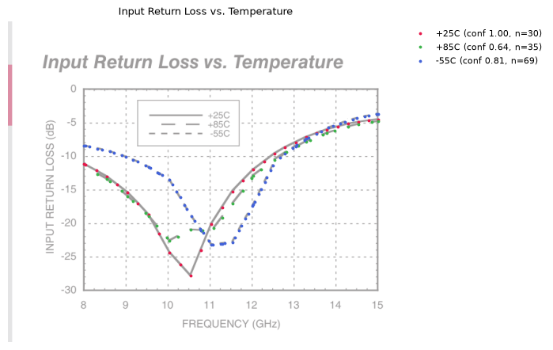
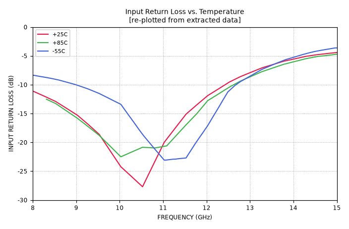

# plot-extractor

Pull the curve data out of the plots in PDF datasheets, at scale and offline.

Most modern datasheets draw their plots as vector graphics. `plot-extractor` reads those PDF drawing commands directly rather than looking at pixels. It finds each plot, calibrates its axes from the tick labels, matches every curve to its legend entry, and writes the points out as JSON and CSV. Because the points come straight from the coordinates the plotting software wrote, they're as accurate as the original drawing. Each result also gets a confidence score and two check images, so you can triage a batch of thousands without opening every PDF.

| Original plot with extracted points overlaid | Re-plotted from the extracted data alone |
|---|---|
|  |  |

*HMC576 input return loss: the three temperature curves are told apart by dash pattern alone.*

---

## Contents

- [Quick start](#quick-start)
- [Drop-folder automation](#drop-folder-automation-github-actions)
- [Outputs](#outputs)
- [Settings](#settings)
- [Checking results and confidence](#checking-results-and-confidence)
- [Optional: local LLM for metadata](#optional-local-llm-for-metadata)
- [Python API](#python-api)
- [How it works](#how-it-works)
- [Limitations and roadmap](#limitations-and-roadmap)
- [Development](#development)

---

## Quick start

Requires Python 3.10 or newer. Dependencies are PyMuPDF, NumPy, SciPy and Matplotlib, all pip-installable on Linux, macOS and Windows.

```bash
git clone https://github.com/livethisdream/plot-extractor
cd plot-extractor
pip install -e .

# one datasheet
plot-extractor path/to/datasheet.pdf -o out/

# a whole library (searched recursively), 8 parallel workers
plot-extractor datasheets/ -o out/ -j 8
```

Console output looks like:

```
[1/1] ok  hmc576.pdf: 7 plots, 25 series, 6 low-conf
done: 1/1 ok -> out/ (index: out/index.jsonl)
```

A typical datasheet takes 2–3 seconds with both images on.

## Drop-folder automation (GitHub Actions)

The repo has a GitHub Actions workflow (`.github/workflows/process-datasheets.yml`) that processes datasheets as they arrive. To use it, add PDFs to `unprocessed/` (subfolders are fine), commit and push. The workflow then:

1. extracts every PDF into `output/<datasheet name>/`;
2. moves each PDF to `processed/`, or to `failed/` if it can't be read, so bad files aren't retried on every push;
3. appends a line per PDF to `output/index.jsonl`;
4. commits the results back to the same branch.

Each run's page under the repo's **Actions** tab shows a results table per datasheet. Runs are queued one at a time, and the bot's own commit doesn't trigger another run.

```
unprocessed/   ← drop PDFs here
processed/     ← PDFs land here after a successful run
failed/        ← PDFs that couldn't be read
output/        ← results, one folder per datasheet, plus index.jsonl
```

If a file with the same name is dropped again, the earlier copy stays in `processed/` with a timestamp suffix, and its outputs are overwritten.

The same flow runs locally, without GitHub:

```bash
python -m plot_extractor.inbox          # uses unprocessed/, processed/, failed/, output/
```

**Keeping datasheets in-house.** By default the job runs on GitHub's servers. To run it on your own machine, which is also needed for the LLM step to reach a model on your network, [register a self-hosted runner](https://docs.github.com/actions/hosting-your-own-runners). Then change `runs-on: ubuntu-latest` to `runs-on: [self-hosted, linux]` in the workflow file.

## Outputs

Each datasheet gets a folder with these files per plot. Files are named `p<page>_<plot#>_<title>`:

| File | Contents |
|---|---|
| `*.json` | title, axis labels, scale (linear or log), tick values, and each series with its label, confidence, notes and `[x, y]` points |
| `*.csv` | the same points, one row each: `series, x, y` |
| `*_overlay.png` | the original plot, faded, with the extracted points drawn on top |
| `*_replot.png` | a fresh chart drawn only from the extracted data and detected axes |
| `summary.json` | one per datasheet: every plot with its series confidences, plus any figures that couldn't be processed |

The batch log `index.jsonl` has one line per PDF:

```json
{"source": "hmc576.pdf", "ok": true, "plots": 7, "series": 25, "low_confidence_series": 6, "raster_figures": 0, "moved_to": "processed/hmc576.pdf", "seconds": 2.53}
```

Example plot JSON (shortened):

```json
{
 "page": 3,
 "title": "Input Return Loss vs. Temperature",
 "x_axis": {"label": "FREQUENCY (GHz)", "scale": "linear", "ticks": [8, 9, 10, 11, 12, 13, 14, 15]},
 "y_axis": {"label": "INPUT RETURN LOSS (dB)", "scale": "linear", "ticks": [0, -5, -10, -15, -20, -25, -30]},
 "series": [
  {
   "label": "+25C",
   "confidence": 1.0,
   "n_points": 30,
   "ambiguous_with": [],
   "note": "",
   "points": [[7.9906, -11.1], [8.0276, -11.195], [8.2781, -12.041], "..."]
  }
 ]
}
```

Points are the vertices the plotting software drew. For dashed curves, that means each dash's endpoints, so spacing is uneven. Use `interpolate()` (see [Python API](#python-api)) to get values on a regular grid.

## Settings

Every switch works three ways: a command-line flag, an environment variable, or, for the GitHub workflow, a repository variable. Set repository variables under **Settings → Secrets and variables → Actions → Variables**, so you don't have to edit the YAML.

| What | Command-line flag | Environment / repository variable | Default |
|---|---|---|---|
| Skip re-plotted PNGs | `--no-replot` | `PLOTX_REPLOT=false` | on |
| Skip overlay PNGs | `--no-overlay` | `PLOTX_OVERLAY=false` | on |
| LLM endpoint for metadata | `--llm-url URL` | `PLOTX_LLM_URL` | off |
| LLM model name | `--llm-model NAME` | `PLOTX_LLM_MODEL` | `local` |
| Parallel workers | `-j N` | | number of CPU cores |
| Output folder | `-o DIR` (`--out` for `inbox`) | | `out/` (`output/` for `inbox`) |

Skipping both PNGs roughly halves processing time and keeps the repo much smaller on large batches.

## Checking results and confidence

Every series gets a `confidence` between 0 and 1. Anything below about 0.5 is worth a look. `low_confidence_series` in `index.jsonl` counts them per datasheet, so you can sort a batch and review the worst first.

Confidence drops, and a `note` explains why, when:

- **links between dashes needed loose matches**, meaning the gaps or directions didn't fit the legend pattern well;
- **fragments overlap in x**, meaning the series probably picked up pieces of a neighboring curve;
- **the curve has abrupt vertical jumps** between neighboring points, the usual sign of two curves mixed together.

Some cases are reported rather than guessed:

- **Identical legend styles.** Some datasheets draw two series with the same line style. On HMC576 *Output Power vs. Drive Level*, −6 dBm and 0 dBm are both dotted. Those curves come out as `"-6dBm | 0dBm [curve 1 of 2, top to bottom]"`, with `ambiguous_with` listing both labels.
- **Raster figures**, meaning plots embedded as images, are listed in `summary.json` but not extracted.

The two images make review quick. The **overlay** shows whether the points landed on the right curves. The **replot** shows whether the data alone reproduces the plot: if it looks like the datasheet, the extraction worked, and mixed-up series show up as spikes.

## Optional: local LLM for metadata

The numbers always come from the PDF itself. An optional LLM step only turns the free text (title, axis labels, legend labels) into structured fields, for example:

```json
{"y_quantity": "output power", "y_unit": "dBm", "series_variable": "temperature",
 "series_values": [{"label": "+25C", "value": 25, "unit": "C"}, "..."],
 "conditions": {"drive level": "3 dBm"}}
```

It works with any OpenAI-compatible endpoint, such as llama.cpp server, vLLM, Ollama, LM Studio, or a model serving a local agent box:

```bash
plot-extractor datasheets/ -o out/ --llm-url http://hermes.local:8080/v1 --llm-model <model-name>
```

The result lands in each plot's `metadata` field. If the endpoint is unreachable, extraction still completes and the error is recorded there. It uses only the Python standard library, so it adds no dependencies.

An agent can also drive the tool directly: run the command, read `index.jsonl`, and open the overlay and replot images for low-confidence series.

## Python API

```python
from plot_extractor import extract_pdf, write_outputs, interpolate

res = extract_pdf("hmc576.pdf")
for plot in res.plots:
    print(plot.page, plot.frame.title, [(s.label, s.confidence) for s in plot.series])

# y values at chosen x values (linear interpolation)
s = res.plots[0].series[0]
interpolate(s, [20.0, 24.0])

# write JSON/CSV/PNGs like the command line does
write_outputs(res, "out/", overlays=True, replots=True)
```

`s.points` is an `N×2` NumPy array of `[x, y]` in data units, sorted by x. `plot.to_dict()` returns the same structure as the JSON file.

## How it works

1. **Rebuild the lines** (`primitives.py`). PDFs encode curves in several ways, and all are converted to centerline segments with a pen width and color:
   - ordinary drawn lines, including PDF dash patterns;
   - "stroke-to-outline" fills, where each segment is a filled hexagon traced by a square pen (common in ADI/Hittite datasheets);
   - thin filled rectangles;
   - small dot squares;
   - long outline polygons.

   Pen widths are grouped per page, so small estimation errors can't split one curve into two styles.
2. **Find plots and calibrate axes** (`axes.py`). A plot is an evenly spaced column of numbers (the y-axis) paired with a row of numbers just below it (the x-axis). Tick positions are snapped onto the gridlines, then a linear or log mapping from page coordinates to data values is fitted. Calibration error is typically under 0.1% of the axis span.
3. **Read the legend** (`series.py`). Each label inside the plot is paired with the short line sample beside it. Gridlines and the frame are ignored automatically because they're perfectly horizontal or vertical.
4. **Sort fragments into series** (`assign.py`):
   - The legend samples define each series' dash pattern: which pieces it uses (dots, dashes of particular lengths, solid lines) and the gaps between them.
   - Every fragment in the plot is classified by type. Dashes drawn on steep slopes come out longer, and that is allowed for.
   - Fragments are chained into curves by one global optimization that only allows links some legend pattern permits.
   - Each chain is voted into a legend entry, and leftover fragments are attached where they continue a curve's direction.
   - Color and pen width separate series too.
5. **Write and check** (`extract.py`, `overlay.py`): JSON, CSV, overlay and replot images, and summaries.

## Limitations and roadmap

- **Raster figures** (scanned or older datasheets) are detected and listed but not extracted yet. `raster.py` outlines the planned OpenCV + Tesseract approach.
- **Dense same-color clusters.** When several dashed curves run within a few points of each other, fragments can be mixed. Confidence scores and notes flag this.
- **Identical legend styles** can't be resolved from the legend alone; see above.
- **Axes** need at least three numeric tick labels on each axis. Dual y-axis plots, and plots whose tick labels sit inside the frame, aren't handled yet.

Tested so far on ADI's HMC576 datasheet and synthetic plots. Expanding coverage across vendors and drawing styles is the next step.

## Development

```bash
pip install -e .[dev]
pytest
```

| Test | What it covers |
|---|---|
| `tests/test_synthetic.py` | builds a datasheet-style PDF with known curves (solid, dashed, dotted, colored, log axis) and checks accuracy against the true values |
| `tests/test_inbox.py` | the drop-folder flow: a good PDF, a corrupt one, and a reused filename |
| `tests/test_hmc576.py` | regression test on ADI's HMC576; runs when `tests/data/hmc576.pdf` is present (that copy is git-ignored) |

Project layout:

```
plot_extractor/
  primitives.py   PDF drawings -> centerline segments
  axes.py         plot detection and axis calibration
  series.py       legend parsing, fragment chaining, filtering
  assign.py       dash-pattern matching, linking, confidence
  extract.py      pipeline and output writing
  overlay.py      overlay and replot images
  inbox.py        drop-folder processing
  cli.py          plot-extractor command
  llm.py          optional local-LLM metadata step
  raster.py       raster figure detection (extraction not yet implemented)
```
